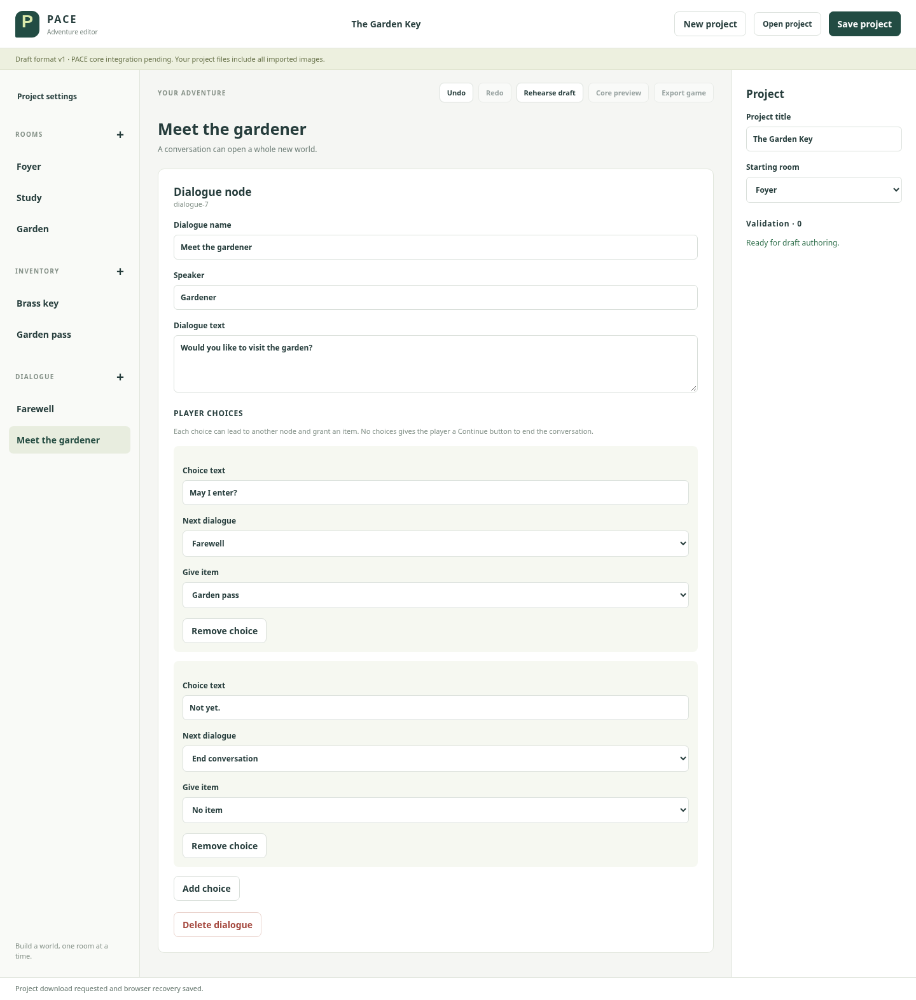
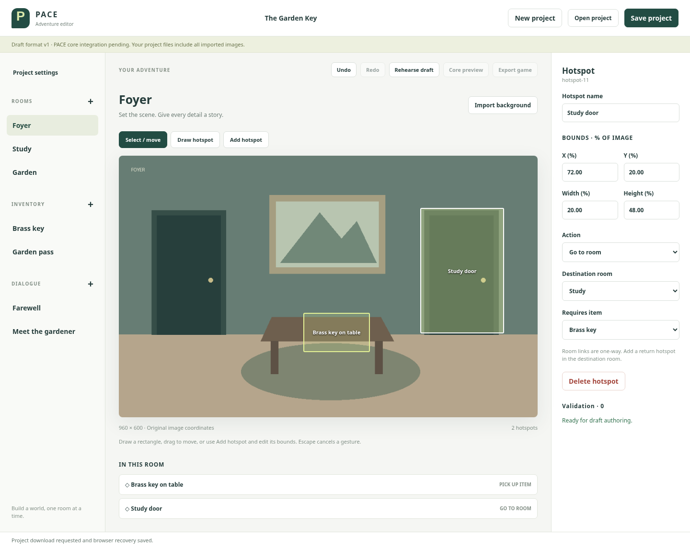
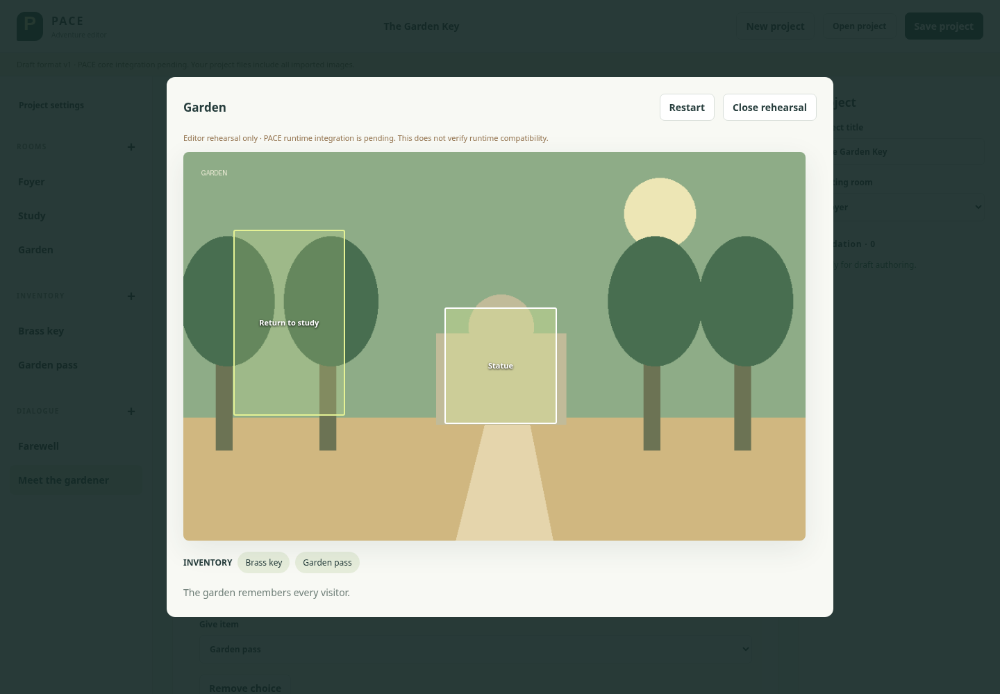

# Author The Garden Key

This walkthrough authors an **editor-owned example** through the UI. It is not
the missing upstream core fixture. Allow about ten minutes. No scene-data editing
is required. Run `trunk serve`, open http://localhost:8080, and keep the three PNGs
in [`fixtures/backgrounds`](../fixtures/backgrounds) handy.

## 1. Set the scene

In **Project settings**, name the adventure **The Garden Key**. Click **+** beside
**ROOMS**, name the room **Foyer**, and use **Import background** to select
`foyer.png`. Repeat for **Study** (`study.png`) and **Garden** (`garden.png`). The
first room becomes the starting room; check **Project settings → Starting room**
to change it. Each room can be selected in the left sidebar.

## 2. Create the things the player can carry

Click **+** beside **INVENTORY**. Name the item **Brass key**, with description
“Opens the study door.” Create a second item named **Garden pass**, with description
“A gift from the gardener.” These are definitions: the player starts with neither.

## 3. Write the conversation

Click **+** beside **DIALOGUE**. Name the node **Farewell**, set **Speaker** to
“Gardener”, and **Dialogue text** to “The garden is waiting for you.” Leave it
without choices; the player will get a Continue button.

Create another node, **Meet the gardener**, with speaker “Gardener” and text
“Would you like to visit the garden?” Click **Add choice**:

- **Choice text:** May I enter?
- **Next dialogue:** Farewell
- **Give item:** Garden pass

Add a second choice, **Not yet.**, leaving its next dialogue as **End conversation**
and its reward as **No item**. Both branches are now authored.



## 4. Place and connect hotspots

Select a room, click **Draw hotspot**, and drag over the intended area. Reverse
drags work too. Use **Select / move** to reposition it. For keyboard-only or exact
placement, click **Add hotspot**, then set its name and percentage bounds in the
right inspector. Arrow keys nudge a focused canvas hotspot by 1%.

The following exact bounds reproduce the example. All coordinates are percentages
of the original background, so they stay aligned when the editor is resized.

| Room | Hotspot name | X, Y, width, height | Action | Target | Requires item |
|---|---|---|---|---|---|
| Foyer | Brass key on table | 44, 60, 16, 15 | Pick up item | Brass key | No requirement |
| Foyer | Study door | 72, 20, 20, 48 | Go to room | Study | Brass key |
| Study | Return to foyer | 8, 20, 18, 48 | Go to room | Foyer | No requirement |
| Study | Talk to gardener | 40, 55, 24, 18 | Start dialogue | Meet the gardener | No requirement |
| Study | Garden gate | 72, 20, 20, 48 | Go to room | Garden | Garden pass |
| Garden | Return to study | 8, 20, 18, 48 | Go to room | Study | No requirement |
| Garden | Statue | 42, 40, 18, 30 | Inspect | The garden remembers every visitor. | No requirement |

For the Statue, enter the target text in **Inspection text**. Links are one-way;
the return hotspots above explicitly create the reverse paths.



## 5. Validate and save

The inspector should show **Validation · 0**. To try an error, temporarily change
Study door's destination to **Choose destination**. Its validation entry includes
the hotspot's stable ID and `action.room_id`. Click the error to select that
hotspot, then choose Study again (or Undo).

Click **Save project** and keep the downloaded `adventure.pace-draft.json`. It
contains every background and all authored fields. Click **New project**, then
**Open project** and select the downloaded file. Everything reappears; importing
the original image files again is unnecessary. Invalid and unsupported files do
not replace the open project. The saved browser recovery copy also opens on a
refresh; it is a convenience, not a substitute for a downloaded project file.

## 6. Rehearse the draft

Click **Rehearse draft**. This is an editor-only simulation on a copy of the
project, not the PACE runtime:

1. Click **Study door** before taking the key. It tells you what is missing.
2. Click **Brass key on table**, then **Study door**. You arrive in the Study.
3. Try **Garden gate**. It requires the Garden pass.
4. Click **Talk to gardener**, then **Not yet.** to try the non-reward branch.
5. Talk again; choose **May I enter?** The pass enters inventory and Farewell runs.
6. Click **Continue**, then **Garden gate**, then **Statue**.
7. Return to Study and Foyer using their return hotspots. **Restart** resets the
   inventory and current room. **Close rehearsal** returns to the unchanged draft.



**Core preview** and **Export game** remain disabled until the upstream core
format and executable runtime exist and can be pinned. See
[the integration boundary](core-integration.md). Do not treat rehearsal as proof
of core compatibility.

## Reproduce the evidence

`tests/e2e/authoring.spec.ts` performs the entire authoring workflow using browser
controls, verifies both dialogue choices and the gated room transitions, then
saves, reopens, and deeply compares the project—including embedded backgrounds.
No test writes scene data into the page to create the example.

```sh
trunk build
npm ci
npx playwright install chromium
npm run test:e2e
```

To regenerate the committed example and screenshots from those same UI actions:

```sh
UPDATE_WALKTHROUGH=1 npm run test:e2e -- authoring.spec.ts
```

The fixture is [`three-rooms.pace-draft.json`](../fixtures/three-rooms.pace-draft.json).
The background illustrations were generated for this repository and contain no
external assets.
